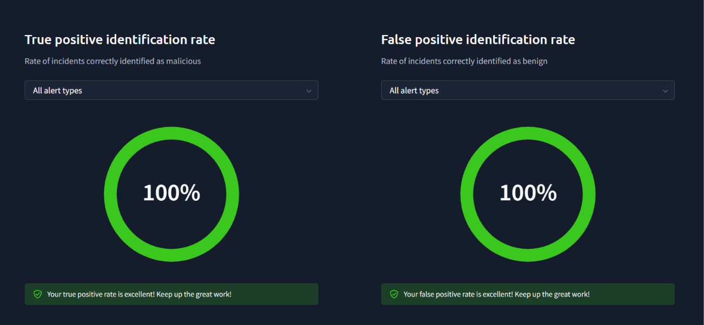
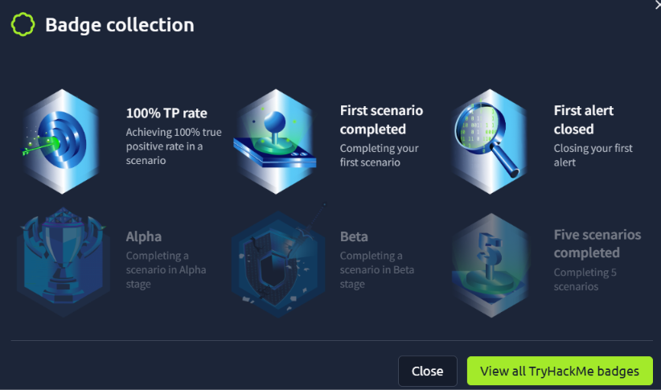
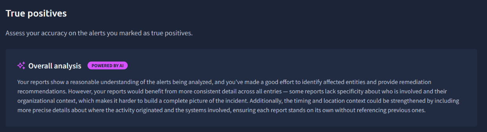

# SOC Investigation Report
## Executive Summary 
Investigation Report as part of SOC project involving - Phishing Detection + SIEM log analysis + VirusTotal + Alert Traige + True-positive / False-positive identification + IOCs + Alert Report Writing + Escalation where required, in a simulated SOC environment on THM.  

## Project Objectives
- Understand SIEM-generated phishing alerts.  
- Perform initial alert triage.
- Investigate suspicious email indicators.
- Use VirusTotal for threat intelligence.
- Distinguish true positives from false positives.  

## Lab Environment & Tools  
- TryHackMe SOC Simulator
- SIEM platform: Splunk
- Threat Intelligence: VirusTotal

## Some snapshots as achivements from the result of the scenario:  

   - 100% True-positive and False-positive rate in the sceanrio.
          

          

   - AI analysis of the reports and the investigation done by me. I will do my best to overcome these shortcomings of mine.

        

## For detailed investigation report- 

 