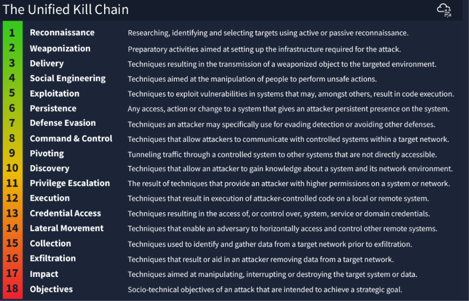
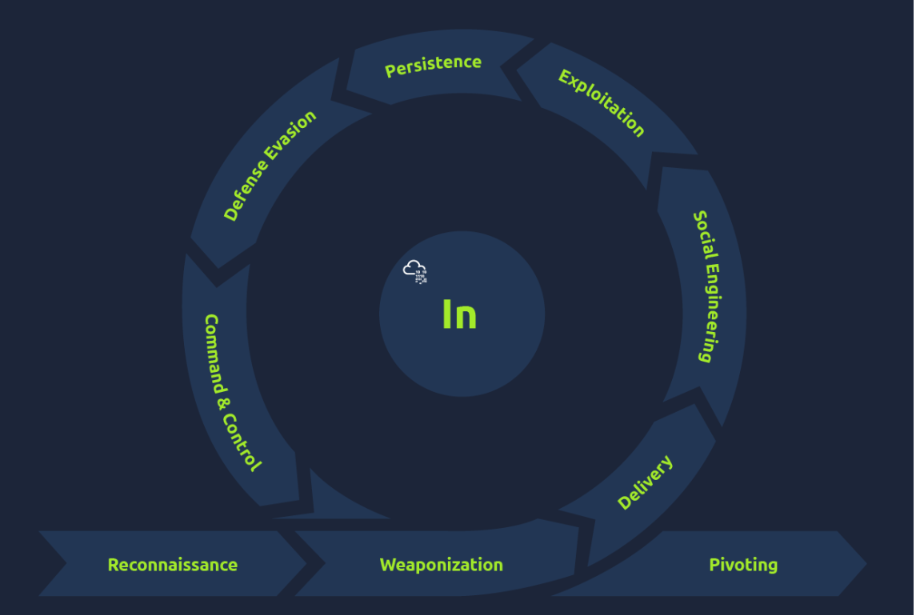
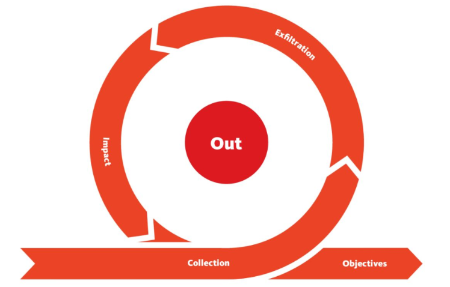

# Module 4: Cyber Defence Frameworks
## Room 3: Unified Kill Chain
### What I learned about:
- A “Kill Chain” is a term used to explain the various stages of an attack. In the realm of cybersecurity, a “Kill Chain” is used to describe the methodology/path attackers such as hackers or APTs use to approach and intrude a target. UKC (Unified Kill Chain) framework is used to help understand how cyber attacks occur.  
Understanding the behaviours, objectives and methodologies of a cyber threat is a vital step to establishing a strong cybersecurity defence (known as a cybersecurity posture).
- **Threat modelling**, in a cybersecurity context, is a series of steps to ultimately improve the security of a system. Threat modeling is the systematic process of-  
    - Identifying critical assets  
    - Assessing their vulnerabilities  
    - Implementing actionable defenses and long-term policies to protect them from exploitation.   

  The UKC can encourage threat modelling as the UKC framework helps identify potential attack surfaces and how these systems may be exploited.  
  **STRIDE** (Spoofing, Tampering, Repudiation, Information Disclosure, Denial of Service (DoS), and Elevation of Privilege), **DREAD** (A system used by microsoft to assess risk to computer security threats)and **CVSS** (Common Vulnerability Scoring System) are all frameworks specifically used in threat modelling.
   
- **Paul Pols' Unified Kill Chain**, published in 2017, aims to complement (not compete with) other cybersecurity kill chain frameworks, such as Lockheed Martin’s and MITRE’s ATT&CK.  
The UKC states that there are 18 phases to an attack: Everything from reconnaissance to data exfiltration and understanding an attacker's motive.   
    > Note: Some large benefits of the UKC over traditional cybersecurity kill chain frameworks include the fact that it is modern and extremely detailed.    

      
    
    - Goal: In (Initial Foothold)  

       

       (1) **Reconnaissance (MITRE Tactic TA0043)**    
           This phase of the UKC describes techniques that an adversary employs to gather information relating to their target, achieved through means of passive and active reconnaissance.  
           Information gathered from this phase can include:

        - Discovering what systems and services are running on the target (beneficial information in the weaponisation and exploitation phases of this section).  
        - Finding contact lists or lists of employees (for impersonation or social engineering or phishing attack).  
        - Looking for potential credentials.  
        - Understanding the network topology and other networked systems. 

        (2) **Weaponization (MITRE Tactic TA0001)**    
            This phase of the UKC describes the adversary setting up the necessary infrastructure to perform the attack.  
            For example, this could be setting up a command and control server, or a system capable of catching reverse shells and delivering payloads to the system.  
        
        (3) **Social Engineering (MITRE Tactic TA0001)**   
            This phase of the UKC describes techniques that an adversary can employ to manipulate employees to perform actions that will aid in the adversaries attack.  
        
        (4) **Exploitation (MITRE Tactic TA0002)**  
            This phase of the UKC describes how an attacker takes advantage of weaknesses or vulnerabilities present in a system. For example- 

        - Uploading and executing a reverse shell to a web application.
        - Interfering with an automated script on the system to execute code.
        - Abusing a web application vulnerability to execute code on the system it is running on.
        
        (5) **Persistence (MITRE Tactic TA0003)**   
            This phase of the UKC describes the techniques an adversary uses to maintain access to a system they have gained an initial foothold on.  For example:

        - Creating a service on the target system that will allow the attacker to regain access.
        - Adding the target system to a Command & Control server where commands can be executed remotely at any time.
        - Leaving other forms of backdoors that execute when a certain action occurs on the system (i.e. a reverse shell will execute when a system administrator logs in).  

        (6) **Defence Evasion (MITRE Tactic TA0005)**   
           This phase is used to understand the techniques an adversary uses to evade defensive measures put in place in the system or network. 
        
        (7) **Command & Control (MITRE Tactic TA0011)**   
            The "Command & Control" phase of the UKC combines the efforts an adversary made during the "Weaponization" stage of the UKC to establish communications between the adversary and target system.

        (8) **Pivoting (MITRE Tactic TA0008)**  
            "Pivoting" is the technique an adversary uses to reach other systems within a network that are not otherwise accessible (for example, they are not exposed to the internet).  

    - Goal: Through (Network Propagation)  

       -  The "Through" goal follows a successful foothold being established on the target network. If defensive controls prevent the attacker from achieving their objective, they will seek to gain additional access and privileges to systems. The attacker would set up a base on one of the systems to act as their pivot point and use it to gather information about the internal network.  

          

        - **Pivoting (MITRE Tactic TA0008)**    
            Once the attacker has access to the system, they would use it as their staging site and a tunnel between their command operations and the victim’s network. The system would also be used as the distribution point for all malware and backdoors at later stages.

        - **Discovery (MITRE Tactic TA0007)**   
            The adversary would uncover information about the system and the network it is connected to.

        - **Privilege Escalation (MITRE Tactic TA0004)**   
            The adversary would leverage the information on the accounts present with vulnerabilities and misconfigurations found to elevate their access to superior levels.

        - **Execution (MITRE Tactic TA0002)**  
            Remote trojans, C2 scripts, malicious links and scheduled tasks are deployed and created to facilitate a recurring presence on the system and uphold their persistence.

        - **Credential Access (MITRE Tactic TA0006)**  
            Working hand in hand with the Privilege Escalation stage, the adversary would attempt to steal account names and passwords through various methods, including keylogging and credential dumping. This makes them harder to detect during their attack as they would be using legitimate credentials.

        - **Lateral Movement (MITRE Tactic TA0008)**  
            With the credentials and elevated privileges, the adversary would seek to move through the network and jump onto other targeted systems to achieve their primary objective.   
            *The stealthier the technique used, the better.*
    
    - Goal: Out (Action on Objectives)  

        - The "Out" goal wraps up the journey of an adversary’s attack on an environment, where they have critical asset access and can fulfil their attack goals.  

           
           
        - **Collection (MITRE Tactic TA0009)**  
            After all the hunting for access and assets, the adversary will be seeking to gather all the valuable data of interest. The main target sources include drives, browsers, audio, video and email.

        - **Exfiltration (MITRE Tactic TA0010)**  
            To elevate their compromise, the adversary would seek to steal data, which would be packaged using encryption measures and compression to avoid any detection. The C2 channel and tunnel deployed in the earlier phases will come in handy during this process.

        - **Impact (MITRE Tactic TA0040)**   
            If the adversary seeks to compromise the integrity and availability of the data assets, they would manipulate, interrupt or destroy these assets. 

        - **Objectives**  
            With all the power and access to the systems and network, the adversary would seek to achieve their strategic goal for the attack. For example, if the attack was financially motivated, they may seek to encrypt files and systems with ransomware and ask for payment to release the data. In other instances, the attacker may seek to damage the reputation of the business, and they would release private and confidential information to the public.

### Key Learnings
- Why and how UKC framework is important and helpful in establishing a good cybersecurity posture.  
- Use of UKC to understand an attacker's motivation, methodologies and tactics.
- Understood various phases of UKC.
- UKC is a framework that is used to complement other frameworks such as MITRE. 