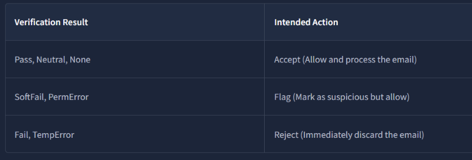
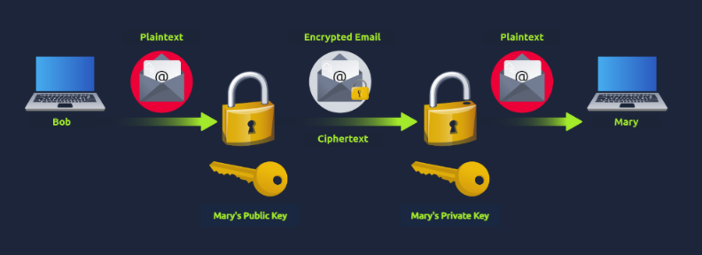

# Module 5: Phishing Analysis
## Room 4: Phishing Prevention
### What I learned about:
- **Sender Policy Framework (SPF)** is used to authenticate the sender of an email. With an SPF record in place, Internet Service Providers can verify that a mail server is authorized to send email for a specific domain. An SPF record is a DNS TXT record containing a list of the IP addresses that are allowed to send email on behalf of your domain.  
So, in essence, when an email is sent, the receiving mail server checks the domain's SPF record to verify whether the sending server is authorized to send messages on behalf of that domain. The delivery of the email (intended action) is based on the result of the SPF record verification.  

- **SPF Record**  
    v=spf1 ip4:127.0.0.1 include:_spf.google.com -all

    v=spf1 Signifies the start of the SPF record  
    ip4:127.0.0.1 Specifies which IP can send mail (IPv4 in this case)  
    include:_spf.google.com Specifies which domain can send mail  
    -all Non-authorized emails will be rejected  

- [**The SPF Surveyor tool**](https://dmarcian.com/spf-survey/) from dmarcian enables us to gain a visual look at DNS records. It also helps ensure the record uses the correct syntax.
- Google Admin Toolbox [Messageheader](https://toolbox.googleapps.com/apps/messageheader/) allows you to analyze delivery details using an email's full header.  
A SoftFail means the sending mail server is not listed as an authorized sender, but the receiving server will still accept the email and flag it as suspicious. In this case, the sending IP address could not be verified.
- **DKIM stands for DomainKeys Identified Mail** and is used for the authentication of an email that’s being sent. Like SPF, DKIM is an open standard for email authentication that is used for DMARC alignment. A DKIM record exists in the DNS, but it is more complex than SPF. DKIM’s advantage is that it can survive forwarding, which makes it superior to SPF and a foundation for securing your email.  
    - When an email is sent, the sending mail server uses a private key to add a digital signature to the email.  
    - The receiving server retrieves the public key from the domain's DKIM record to verify that the message truly came from the domain.  
    - If the signature matches, the email is authentic; otherwise, it may be flagged or rejected. 
    - **DKIM Records**  
        v=DKIM1; k=rsa; p=<public_key>

        v=DKIM1 Specifies the version of DKIM being used (optional)  
        k=rsa The key type. The RSA encryption algorithm is standard  
        p= This is the public key that will be matched to the private key to verify the DKIM signature  

- **DMARC or Domain-Based Message Authentication, Reporting, and Conformance**, an open source standard, uses a concept called alignment to tie the result of two other open source standards,  SPF (a published list of servers that are authorized to send email on behalf of a domain) and DKIM (a tamper-evident domain seal associated with a piece of email), to the content of an email.  
    - DMARC ensures the sender's domain matches the domains verified by SPF and DKIM. If the alignment fails, DMARC instructs the recipient server on how to handle the email based on a policy specified in the record.  
    - **DMARC Records**   
    v=DMARC1; p=quarantine; rua=mailto:postmaster@website.com  

        v=DMARC1: The version of DMARC (required)  

        p=quarantine The DMARC policy (quarantine = move to the spam folder)  

        rua=mailto:postmaster@website.com An optional tag. In this case, aggregate reports will be sent to the email specified  

    - [Domain Checker](https://dmarcian.com/domain-checker/) Another great tool by dmarcian that inspects DMARC, SPF, and DKIM records to identify any issues. 

- **Secure/Multipurpose Internet Mail Extensions (S/MIME)** is a standard protocol for sending digitally signed and encrypted messages. It is based on public key cryptography, where the private key is never shared and the public key can be distributed openly. The two main components of S/MIME are: Digital Signature and Encryption.   

     

- **Some modern solutions that enhance email security and reduce phishing risks.**  
    - **Technical Defenses:**  
        - [Email Filtering](https://www.spamhaus.org/resource-hub/ip-domain-reputation/): Provides filtering based on IP and domain reputation, allowing for blocking or quarantining of suspicious messages.
        - [Secure Email Gateways (SEGs)](https://www.cloudflare.com/learning/email-security/secure-email-gateway-seg/): Scan messages to detect impersonation attempts, spoofing, and other phishing techniques that other filters might miss.
        - [Link Rewriting](https://learn.microsoft.com/en-us/defender-office-365/safe-links-about): Replaces suspicious or unknown URLs with safe, redirected ones, giving the system time to scan and verify the link.  

        - [Sandboxing](https://learn.microsoft.com/en-us/defender-office-365/safe-attachments-about): Isolates and tests suspicious links or attachments in a secure, virtual environment to check for malicious behavior.  

    - **User-Facing Tools & Training**  
        - Trust & Warning Indicators: Modern email platforms display visual cues to help users understand if a message is safe. A banner may read “External Sender,” “Suspicious Link,” or signify that a message is from a trusted organization or sender.   

        - Phishing Reporting: Easy, in-email reporting options that let users quickly report suspicious messages.
        - User Awareness Training: Train employees on identifying phishing attempts, social engineering tactics, and safe email practices.
        - Phishing Simulation Exercises: Run controlled phishing campaigns to test and reinforce employee training.  

### Key Learning
- Explored how technologies like SPF, DKIM, DMARC, and S/MIME work together to authenticate email and protect users against phishing.  
- Examined the tools and technologies organizations use to detect and prevent phishing attempts, combined with user-focused awareness and reporting mechanisms

